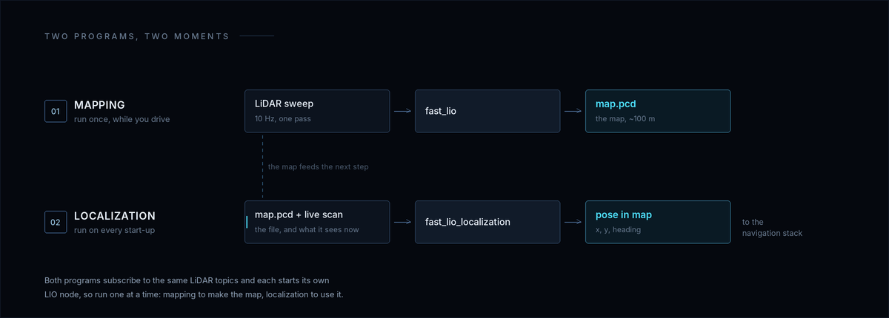
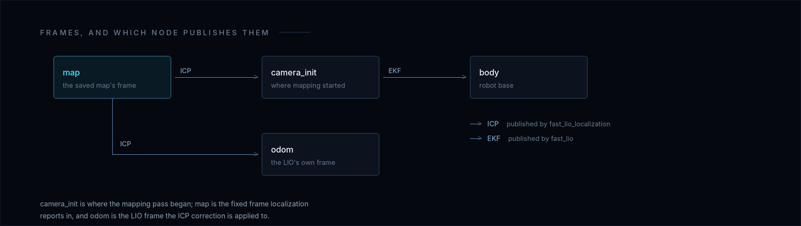
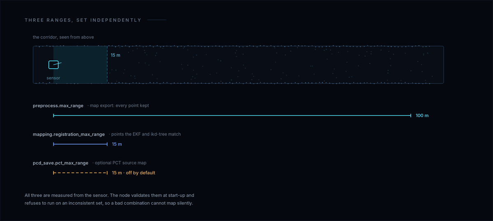

<p align="center">
  
</p>

<p align="center">
  <b>English</b> | <a href="README.zh-CN.md">简体中文</a>
</p>

<p align="center">
  <a href="LICENSE"></a>
  
  
  <a href="https://github.com/limxdynamics/tron2-navigation-fastlio-gpl/tags"></a>
  <a href="https://github.com/hku-mars/FAST_LIO"></a>
</p>

# FAST-LIO: map a floor, then find yourself on it

`fast_lio` builds a point-cloud map: drive the robot through a building once and
it accumulates every sweep into a single `.pcd` file. `fast_lio_localization`
loads that file and, on each later start-up, matches the live scan against it to
report where the robot stands. No GPS, no fiducial markers, no pre-surveyed plan
— and neither node needs the navigation stack to be running.

> This repository publishes the complete source for the two GPL-2.0-only
> FAST-LIO runtime units the LimX ROS 2 navigation integration requires:
> `FAST_LIO` (mapping/LIO) and `FAST_LIO_LOCALIZATION2` (map localization), each
> with its embedded `ikd-Tree`, GPLv2 text, upstream attribution, baseline commit
> and modification notice. No license here is changed to Apache or BSD.

<p align="center">
  
</p>

<p align="center"><sub>One drive writes <code>map.pcd</code>; every start-up after that turns the live scan into a pose inside it.</sub></p>

## What is in this repository

| Path | What it does |
| --- | --- |
| `FAST_LIO/` | Mapping package `fast_lio`: EKF scan-to-map, `/map_save`, RoboSense profile, launch, RViz |
| `FAST_LIO_LOCALIZATION2/` | Localization package `fast_lio_localization`: Open3D ICP against the saved map, transform fusion, initial-pose helper |
| `FAST_LIO*/include/ikd-Tree/` | Incremental kd-tree used by the EKF update |
| `SOURCE_INVENTORY.sha256`, `audit_source.sh` | Per-file hash lock and its checker |

## Requirements

ROS 2 Humble on Ubuntu 22.04, plus the dependencies in both manifests. The
Python ones are not on every image:

```bash
sudo apt install ros-humble-pcl-ros python3-transforms3d python3-open3d
```

A RoboSense RSFAIRY needs its separately licensed driver built and sourced; the
profile expects `/rslidar_points` (`PointCloud2`) and `/rslidar_imu_data` (`Imu`)
from it, with no bridge node. `livox_ros_driver2` is optional at configure time —
without it the packages build PointCloud2-only support, which is what this
profile uses; upstream FAST-LIO requires it. Keep the Ubuntu NumPy ahead of
anything under `/usr/local`, so it stays ABI-compatible with the packaged
Open3D. The robot must stand still during IMU initialisation: `rs_fairy.yaml`
sets `mapping.gravity_align_world: true`, and that alignment is only correct if
the IMU is quiet.

## Build

```bash
source /opt/ros/humble/setup.bash
colcon build \
  --base-paths FAST_LIO FAST_LIO_LOCALIZATION2 \
  --packages-select fast_lio fast_lio_localization \
  --build-base build \
  --install-base install \
  --merge-install \
  --symlink-install \
  --cmake-force-configure \
  --cmake-args -DCMAKE_BUILD_TYPE=Release
source install/setup.bash
```

The navigation integration builds this repository into a prefix of its own; the
two meet at runtime over ROS 2 topics and TF.

## Run the mapping unit

```bash
ros2 launch fast_lio mapping.launch.py map_file_path:=$HOME/maps/rs_fairy_map.pcd
```

Drive or push the robot through the area once, then save:

```bash
ros2 service call /map_save std_srvs/srv/Trigger
```

`/map_save` writes `map_file_path` and, when configured, `pct_map_file_path`,
answering with the paths it wrote. It needs `pcd_save.pcd_save_en: true`, which
`rs_fairy.yaml` sets; otherwise it answers `Map save disabled.`

| Argument | Default | Role |
| --- | --- | --- |
| `config_file` | `rs_fairy.yaml` | Profile under `FAST_LIO/config/` |
| `map_file_path` | `rs_fairy_map.pcd` | Map written by `/map_save`; overrides the YAML value |
| `pct_map_file_path` | empty | Optional near-field PCT source map |
| `pct_max_range` | `0.0` | Range kept in the PCT source map; `0` disables it |
| `registration_max_range` | `15.0` | Range used by scan-to-map registration |
| `rviz` | `true` | Start RViz 2 with `rviz/fastlio.rviz` |

## Run the localization unit

```bash
ros2 launch fast_lio_localization localization.launch.py map:=$HOME/maps/rs_fairy_map.pcd
```

Then give the start pose, with RViz 2's **2D Pose Estimate** or the helper below
(arguments are `x y z yaw pitch roll`, in radians):

```bash
ros2 run fast_lio_localization publish_initial_pose 0.0 0.0 0.0 0.0 0.0 0.0
```

It publishes `/initialpose` three times and exits non-zero if nothing subscribes
within five seconds. Until ICP accepts a match the nodes stay quiet, because
`publish_before_localization` defaults to `false`: set it `true` for an
identity-aligned pose, or expect no output before the first match.

| Argument | Default | Role |
| --- | --- | --- |
| `map` | empty, required | Path to the `.pcd` map |
| `config_file` | `rs_fairy.yaml` | LIO profile used by the localization node |
| `frame_id` | `map` | Fixed navigation frame |
| `pose_topic` | `/pose_stamped` | Pose output for the navigation stack |
| `base_yaw_offset_deg` | `60.0` | Fixed yaw from the LiDAR/IMU pose to the robot base |
| `z_offset` | `0.0` | Height offset applied to the published pose |
| `publish_before_localization` | `false` | Publish an identity pose before ICP succeeds |
| `rviz` | `true` | Start RViz 2 with `rviz/fastlio_localization.rviz` |

`base_yaw_offset_deg` depends on how the LiDAR is mounted: `60.0` is the
established TRON2 value, and another mount needs its own or the pose is rotated
about Z by a constant. The ICP settings are not launch arguments —
`map_voxel_size` `0.4`, `scan_voxel_size` `0.1`, `localization_threshold` `0.8`,
`freq_localization` `0.5` Hz — edit `localization.launch.py` to change them.

Both launch files start their own LIO node on the same LiDAR topics, so run one
unit at a time.

## Topics and frames

| Direction | Name | Type | Notes |
| --- | --- | --- | --- |
| in | `/rslidar_points` | `sensor_msgs/PointCloud2` | `common.lid_topic` |
| in | `/rslidar_imu_data` | `sensor_msgs/Imu` | `common.imu_topic` |
| in | `/initialpose` | `geometry_msgs/PoseWithCovarianceStamped` | Localization only |
| out | `/cloud_registered` | `sensor_msgs/PointCloud2` | Scan in the map frame |
| out | `/Laser_map` | `sensor_msgs/PointCloud2` | Accumulated map, mapping only |
| out | `/Odometry` | `nav_msgs/Odometry` | LIO odometry |
| out | `/path` | `nav_msgs/Path` | Trajectory |
| out | `/pose_stamped` | `geometry_msgs/PoseStamped` | Localization output |
| out | `/map_to_odom` | `nav_msgs/Odometry` | ICP correction, localization only |
| out | `/corrected_current_pcd` | `sensor_msgs/PointCloud2` | Live scan placed in `map` |
| service | `/map_save` | `std_srvs/srv/Trigger` | Writes the map PCD files |

Mapping publishes in `camera_init`; localization publishes `map → camera_init`
and `map → odom` and reports the base pose in `map`.

<p align="center">
  
</p>

<p align="center"><sub>Localization adds <code>map → camera_init</code> and <code>map → odom</code>; mapping owns <code>camera_init → body</code>. Read the pose in <code>map</code>.</sub></p>


## v1.1.0 mapping contract

Three independent range policies:

- `preprocess.max_range` — full points kept and exported (`100.0`);
- `mapping.registration_max_range` — points the EKF and ikd-tree match against (`15.0`);
- `pcd_save.pct_max_range` — points kept in the optional PCT source map (`0.0`).

<p align="center">
  
</p>

<p align="center"><sub>The three ranges are independent: the whole corridor is exported, only the near field is matched, and the PCT source map is opt-in.</sub></p>

The node validates them at start-up and refuses to run on an inconsistent set:
`registration_max_range` must be finite, non-negative, above `preprocess.blind`
(`0.5`) and no greater than `preprocess.max_range`; `pct_map_file_path` and
`pcd_save.pct_max_range` must be set together, and a PCT source map also needs
`pcd_save.use_all_frames: true`, `pcd_save.interval <= 0` and a path different
from `map_file_path`.

When both maps are configured, `/map_save` writes each to a temporary file and
commits the set: the previous files are backed up, the new ones renamed into
place, and any failure restores the backup. One new map can never be paired with
one old one, so do not mix maps from different sessions. The companion
integration repository records the session manifest binding these files to the
`camera_init` frame.

## Source integrity

```bash
./audit_source.sh
```

`SOURCE_INVENTORY.sha256` locks every distributed file except itself. The script
(needs `file`, `git`, `sha256sum`) checks the hashes and the file set, that both
`package.xml` declare `GPL-2.0-only`, that each `NOTICE` records its baseline and
scope, and that the tree holds no generated objects, maps, recordings, private
addresses, machine paths or files over 25 MiB; it prints `GPL_SOURCE_AUDIT=PASS`.
Adding a file means recomputing the inventory in the same commit.

## Integration boundary

The navigation system checks this repository out separately and builds it into
its own prefix; runtime communication with RSLIDAR, PCT and SCAN uses ROS 2/DDS
messages and TF. That engineering boundary does not alter GPL obligations or
settle any aggregation/derivative-work question.

- <https://github.com/limxdynamics/tron2-navigation-ros2>
- <https://github.com/limxdynamics/tron2-navigation-pct-gpl>

## This source snapshot

| Directory | Upstream | Baseline commit |
| --- | --- | --- |
| `FAST_LIO` | <https://github.com/Ericsii/FAST_LIO.git> | `2fffc570a25d0df172720bac034fbdb6a13d2162` |
| `FAST_LIO_LOCALIZATION2` | <https://github.com/Smart-Wheelchair-RRC/FAST_LIO_LOCALIZATION2.git> | `f04974907c8da976dd0495b272d18ac4c534d41f` |

The local changes are the ROS 2 Humble/aarch64 and RSFAIRY adaptations: mapping
and map save, gravity alignment, initial-pose localization, transform fusion,
base-yaw handling, shutdown safety, and the v1.1.0 range split. Read
[RELEASE_INFO.md](RELEASE_INFO.md), [FAST_LIO/NOTICE](FAST_LIO/NOTICE) and
[FAST_LIO_LOCALIZATION2/NOTICE](FAST_LIO_LOCALIZATION2/NOTICE) for authoritative
provenance. Site calibration, maps, robot credentials, endpoint values, generated
binaries and install prefixes are intentionally absent: runtime data, not
corresponding source.

The `v1.1.0` tag marks the source release the navigation integration fetches;
`master` carries later documentation-only commits.

## License

The derivative programs are distributed under GNU GPL version 2 only. Read the
root [LICENSE](LICENSE), each component's `LICENSE`, and both `NOTICE` files. The
software is provided without warranty.
