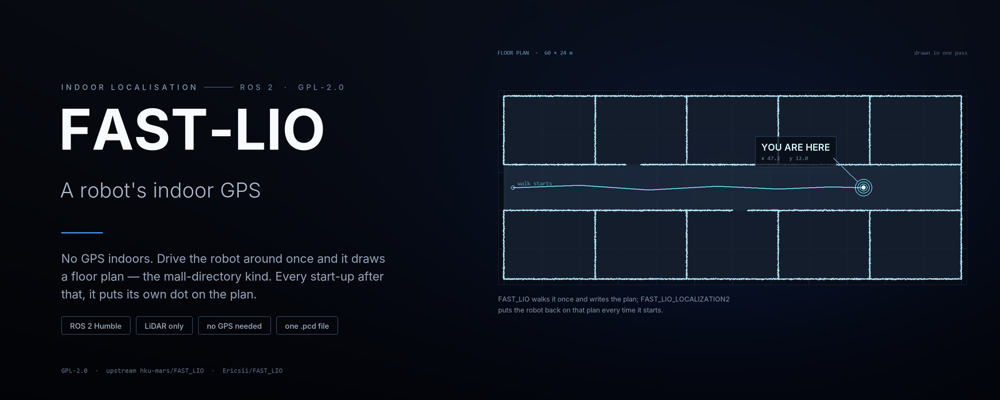

<p align="center">
  
</p>

<p align="center">
  <a href="README.md">English</a> | <b>简体中文</b>
</p>

<p align="center">
  <a href="LICENSE"></a>
  
  
  <a href="https://github.com/limxdynamics/tron2-navigation-fastlio-gpl/tags"></a>
  <a href="https://github.com/hku-mars/FAST_LIO"></a>
</p>

# FAST-LIO：先建一张楼层图，再在图里找到自己

`fast_lio` 是一个激光雷达惯性里程计节点。带着机器人把一栋楼走一遍，它会把每一帧扫描累积成一张点云地图，存成一个 `.pcd` 文件。`fast_lio_localization` 加载这份地图，之后每次开机都把实时扫描和地图配准，报出机器人站在图里的哪个位置。

两个节点都不需要 GPS、不需要贴标记、不需要事先测好的平面图，也不需要导航栈同时运行。

> 本仓库按 GPL-2.0-only 公开 LimX ROS 2 导航集成所依赖的两个 FAST-LIO 运行时单元的完整源码：`FAST_LIO`（ROS 2 建图/LIO 衍生版）与 `FAST_LIO_LOCALIZATION2`（ROS 2 地图定位衍生版）。两个目录都包含内嵌的 `ikd-Tree` 源码、包构建文件、GPLv2 许可证全文、上游署名、基线提交与本地修改声明。本仓库中的任何许可证都没有被改成 Apache 或 BSD。

## 亮点

- **走一遍就有地图，起一次就有位姿。** 每帧扫描都跟已经建好的地图配准，累积出来的点云本身就是地图，没有单独的建图环节要调度。
- **100 m 的地图，15 m 的配准。** 全量点保留在导出的地图里，而 scan-to-map 只用近场点，长走廊不会把 EKF 拖到稀疏的远处回波上。
- **两份 PCD 一起成功或一起不变。** 配了 PCT 源地图时，`/map_save` 先把两份文件都写成临时文件再一起换上；中间失败时保留上一对文件，不会出现新地图配旧地图。
- **参数不一致就拒绝启动。** 量程设置互相矛盾时，节点在启动阶段带原因退出，而不是悄悄用错过滤参数继续建图。
- **不强制装 Livox 驱动。** `livox_ros_driver2` 在 configure 阶段是可选的；没有它，包会构建成只支持 PointCloud2 的激光雷达，也就是 RoboSense 配置用的那一路。上游 FAST-LIO 是强制要求的。

## 仓库组成

| 路径 | 作用 | 语言 |
| --- | --- | --- |
| `FAST_LIO/` | 建图/LIO 包 `fast_lio`，RoboSense 配置、launch、RViz 布局 | C++、Python |
| `FAST_LIO/src/laserMapping.cpp` | EKF scan-to-map，发布里程计与点云，提供 `/map_save` | C++ |
| `FAST_LIO/src/preprocess.cpp` | 去畸变与各雷达的点解析 | C++ |
| `FAST_LIO/launch/mapping.launch.py` | 下文的建图启动参数 | Python |
| `FAST_LIO/config/rs_fairy.yaml` | 随仓库提供的 RSFAIRY 配置 | YAML |
| `FAST_LIO_LOCALIZATION2/` | 定位包 `fast_lio_localization` | C++、Python |
| `FAST_LIO_LOCALIZATION2/fast_lio_localization/global_localization.py` | 用 Open3D ICP 对已保存的地图配准，按 fitness 阈值判定 | Python |
| `FAST_LIO_LOCALIZATION2/fast_lio_localization/transform_fusion.py` | 发布 `map → camera_init` 与 `map → odom`，再输出位姿 | Python |
| `FAST_LIO_LOCALIZATION2/fast_lio_localization/publish_initial_pose.py` | 从命令行发布 `/initialpose` | Python |
| `FAST_LIO*/include/ikd-Tree/` | EKF 更新用的增量 kd-tree | C++ |
| `SOURCE_INVENTORY.sha256`、`audit_source.sh` | 逐文件哈希清单与校验脚本 | Bash |

## 环境要求

Ubuntu 22.04 上的 ROS 2 Humble，加上两个 package manifest 里声明的依赖。其中 Python 的几项不是每个镜像都会被 `rosdep` 带上：

```bash
sudo apt install ros-humble-pcl-ros python3-transforms3d python3-open3d
```

`pcl_ros` 提供重新发布已保存地图的 `pcd_to_pointcloud` 节点，`open3d` 负责配准，`transforms3d` 提供四元数转换。让 Ubuntu 自带的 NumPy 优先于装在 `/usr/local` 下的版本，才能跟系统打包的 Open3D 保持 ABI 兼容。

RoboSense RSFAIRY 需要单独构建并 source 它自己的驱动（独立许可证）。配置期望的是标准 ROS 2 接口 `/rslidar_points`（`sensor_msgs/PointCloud2`）与 `/rslidar_imu_data`（`sensor_msgs/Imu`），中间没有桥接节点。

IMU 初始化期间机器人必须静止。`rs_fairy.yaml` 设了 `mapping.gravity_align_world: true`，即使机体起步时略有俯仰，也能让世界 Z 保持竖直；而这一步对齐只有在 IMU 静止时才是对的。

## 编译

在 Ubuntu 22.04 aarch64 上，source ROS 后编译到一个独立的 GPL 安装前缀：

```bash
source /opt/ros/humble/setup.bash
colcon build \
  --base-paths FAST_LIO FAST_LIO_LOCALIZATION2 \
  --packages-select fast_lio fast_lio_localization \
  --build-base build \
  --install-base install \
  --merge-install \
  --symlink-install \
  --cmake-force-configure \
  --cmake-args -DCMAKE_BUILD_TYPE=Release
source install/setup.bash
```

导航集成会把本仓库编译进一个与它自己代码分开的前缀；两者在运行期通过 ROS 2 话题与 TF 相连，而不是在编译期合并。

## 运行建图部分

```bash
ros2 launch fast_lio mapping.launch.py \
  map_file_path:=$HOME/maps/rs_fairy_map.pcd
```

开着或推着机器人把区域走一遍，然后保存地图：

```bash
ros2 service call /map_save std_srvs/srv/Trigger
```

`/map_save` 写 `map_file_path`；配了 `pct_map_file_path` 时也一并写它，并在 `message` 里返回实际写入的路径。保存要求配置里 `pcd_save.pcd_save_en: true`，`rs_fairy.yaml` 已经设好；关掉时服务返回 `Map save disabled.`

### 建图启动参数

| 参数 | 默认值 | 作用 |
| --- | --- | --- |
| `config_file` | `rs_fairy.yaml` | `FAST_LIO/config/` 下的配置文件 |
| `config_path` | 安装后的 `config/` 目录 | 到哪找配置 |
| `map_file_path` | `rs_fairy_map.pcd` | `/map_save` 写出的定位地图 |
| `pct_map_file_path` | 空 | 可选的近场 PCT 源地图 |
| `pct_max_range` | `0.0` | PCT 源地图保留的量程；`0` 表示关闭 |
| `registration_max_range` | `15.0` | scan-to-map 配准使用的量程 |
| `rviz` | `true` | 用 `rviz/fastlio.rviz` 启动 RViz 2 |

launch 里显式设置了 `map_file_path`，所以命令行参数会覆盖 YAML 配置里的值，而不是反过来。

## 运行定位部分

定位需要建图部分产出的地图，还需要一个粗略的起始位置：

```bash
ros2 launch fast_lio_localization localization.launch.py \
  map:=$HOME/maps/rs_fairy_map.pcd
```

然后给初始位姿，用 RViz 2 的 **2D Pose Estimate** 工具，或从命令行给（参数顺序是 `x y z yaw pitch roll`，单位弧度）：

```bash
ros2 run fast_lio_localization publish_initial_pose 0.0 0.0 0.0 0.0 0.0 0.0
```

`publish_initial_pose` 会连发三次 `/initialpose` 然后退出。如果五秒内没有发现订阅者，它会报错退出——实际含义通常是定位节点还没起来。

在 ICP 拿到可接受的结果之前，节点保持沉默：`publish_before_localization` 默认 `false`，此时 `/pose_stamped` 没有内容，修正后的点云也不发布。如果下游在首次匹配前就需要输出，把它设成 `true`，代价是在那之前给出一个按单位矩阵对齐的位姿。

### 定位启动参数

| 参数 | 默认值 | 作用 |
| --- | --- | --- |
| `map` | 空，必填 | `.pcd` 地图路径 |
| `config_file` | `rs_fairy.yaml` | 定位节点用的 LIO 配置 |
| `pcd_map_topic` | `/map` | 已保存地图重新发布的 `PointCloud2` |
| `frame_id` | `map` | 固定的导航坐标系 |
| `pose_topic` | `/pose_stamped` | 导航栈消费的位姿输出 |
| `corrected_cloud_topic` | `/corrected_current_pcd` | 变换到 `map` 的实时扫描 |
| `base_yaw_offset_deg` | `60.0` | 从雷达/IMU 位姿到机器人底盘的固定偏航 |
| `z_offset` | `0.0` | 输出位姿的高度偏移 |
| `publish_before_localization` | `false` | ICP 成功前是否发布单位矩阵对齐的位姿 |
| `rviz` | `true` | 用 `rviz/fastlio_localization.rviz` 启动 RViz 2 |

`base_yaw_offset_deg` 是唯一取决于雷达怎么固定在车上的参数。`60.0` 这个默认值来自既有的 TRON2 安装方式；换一种安装就得给对应的值，否则位姿会绕 Z 轴差一个常量。

ICP 本身的参数写在 launch 文件里，没有暴露成启动参数：`map_voxel_size` `0.4`、`scan_voxel_size` `0.1`、`localization_threshold` `0.8`（fitness 阈值）、`freq_localization` `0.5` Hz。要改就编辑 `localization.launch.py`。

两个 launch 都会各自起一个 LIO 节点，并订阅同一组雷达话题，所以一次只跑一个：建图时跑建图，用图时跑定位。

## 话题、服务与坐标系

| 方向 | 名称 | 类型 | 说明 |
| --- | --- | --- | --- |
| 入 | `/rslidar_points` | `sensor_msgs/PointCloud2` | `common.lid_topic`，来自 RoboSense 驱动 |
| 入 | `/rslidar_imu_data` | `sensor_msgs/Imu` | `common.imu_topic`，同一个驱动 |
| 入 | `/initialpose` | `geometry_msgs/PoseWithCovarianceStamped` | 仅定位 |
| 出 | `/cloud_registered` | `sensor_msgs/PointCloud2` | 地图坐标系下的扫描 |
| 出 | `/cloud_registered_body` | `sensor_msgs/PointCloud2` | 机体系下的扫描 |
| 出 | `/Laser_map` | `sensor_msgs/PointCloud2` | 累积地图，仅建图 |
| 出 | `/Odometry` | `nav_msgs/Odometry` | LIO 里程计 |
| 出 | `/path` | `nav_msgs/Path` | 轨迹 |
| 出 | `/map_to_odom` | `nav_msgs/Odometry` | ICP 修正量，仅定位 |
| 出 | `/pose_stamped` | `geometry_msgs/PoseStamped` | 定位输出 |
| 出 | `/localization` | `nav_msgs/Odometry` | 定位输出的里程计形式 |
| 出 | `/corrected_current_pcd` | `sensor_msgs/PointCloud2` | 放到 `map` 里的实时扫描 |
| 服务 | `/map_save` | `std_srvs/srv/Trigger` | 写出地图 PCD 文件 |

坐标系：建图节点在 `camera_init` 下发布轨迹与位姿；定位节点发布 `map → camera_init` 与 `map → odom`，并在 `map` 下给出机器人底盘位姿。

## v1.1.0 建图约定

建图衍生版可以让三套量程策略各自独立：

- `preprocess.max_range`：为地图导出保留的全量点；
- `mapping.registration_max_range`：EKF scan-to-map 配准与增量 ikd-tree 使用的近场点；
- `pcd_save.pct_max_range`：为构建 PCT 断层地图导出的近场 PCD。

随仓库提供的 RoboSense 配置保留 100 m 的完整定位地图，同时用 15 m 做配准与 PCT 输入。按实际传感器与环境调整这两个值。

这些数字不是随便填的：节点在启动阶段会校验，不一致就拒绝运行。

- `registration_max_range` 必须有限且非负，必须大于 `preprocess.blind`（`0.5`），并且不得超过 `preprocess.max_range`。
- `pct_map_file_path` 与 `pcd_save.pct_max_range` 必须同时设置。
- 使用 PCT 源地图还要求 `pcd_save.use_all_frames: true`、`pcd_save.interval <= 0`，并且路径与 `map_file_path` 不同。

同时配置了 `map_file_path` 与 `pct_map_file_path` 时，`/map_save` 会先把两份 PCD 都准备好，再作为一次可回滚的文件集事务提交：旧文件先备份，新文件再改名落位，任一步失败就恢复备份。失败不可能悄悄留下一份新地图配一份旧地图。伴生的集成仓会写入并校验绑定这些文件与 `camera_init` 坐标系的建图会话清单。不要混用不同建图会话产出的地图。

## 源码完整性

`SOURCE_INVENTORY.sha256` 锁定了除它自己以外的每个分发文件。克隆之后校验整棵树：

```bash
./audit_source.sh
```

脚本需要 `file`、`git`、`sha256sum`。它检查清单与磁盘上的文件是否一致、文件集有没有增删，两个 `package.xml` 是否都声明 `GPL-2.0-only`，每份 `NOTICE` 是否记录了基线提交与修改范围，以及树里有没有生成物、地图、录制包、私网地址、机器路径或超过 25 MiB 的文件。通过时打印 `GPL_SOURCE_AUDIT=PASS`。

由于清单是逐字节锁定的，新增一个文件就要在同一个提交里重算清单；只改文档的话，变动只落在少数几行，其余行保持逐字节不变。

## 集成边界

完整导航系统把本 GPL 仓库与宽松许可的集成仓分开 checkout，并编译到各自独立的前缀。运行期与 RSLIDAR、PCT、SCAN 的通信走 ROS 2/DDS 消息与 TF。这条工程边界不改变 GPL 义务，也不判断任何关于聚合或衍生作品的法律问题。

伴生仓库：

- <https://github.com/limxdynamics/tron2-navigation-ros2>
- <https://github.com/limxdynamics/tron2-navigation-pct-gpl>

## 源码快照

这是伴生 LimX ROS 2 导航集成所期望的完整源码快照。公开的上游提交记录了它的来源，但它们不是这些 ROS 2 Humble 与 RoboSense 衍生版的直接替代品。

| 目录 | 上游 | 基线提交 |
| --- | --- | --- |
| `FAST_LIO` | <https://github.com/Ericsii/FAST_LIO.git> | `2fffc570a25d0df172720bac034fbdb6a13d2162` |
| `FAST_LIO_LOCALIZATION2` | <https://github.com/Smart-Wheelchair-RRC/FAST_LIO_LOCALIZATION2.git> | `f04974907c8da976dd0495b272d18ac4c534d41f` |

本地修改是面向 ROS 2 Humble/aarch64 与 RoboSense RSFAIRY 的适配：建图与地图保存、重力对齐、初始位姿定位、变换融合、底盘偏航处理、退出安全，以及上面描述的 v1.1.0 量程拆分。确切的来源与修改范围见 [RELEASE_INFO.md](RELEASE_INFO.md)、[FAST_LIO/NOTICE](FAST_LIO/NOTICE)、[FAST_LIO_LOCALIZATION2/NOTICE](FAST_LIO_LOCALIZATION2/NOTICE)。

现场标定、地图、机器人凭据、端点值、生成的可执行文件和安装前缀是刻意不包含的：它们是运行期数据，不是对应源码。

`v1.1.0` 标签标记导航集成所取的那份源码发布；`master` 上带着之后的纯文档提交。

## 许可证

衍生程序仅以 GNU GPL 第 2 版分发（GPL-2.0-only）。请阅读根目录的 [LICENSE](LICENSE)、各组件目录下的 `LICENSE`，以及两份 `NOTICE`。本软件不提供任何担保。
